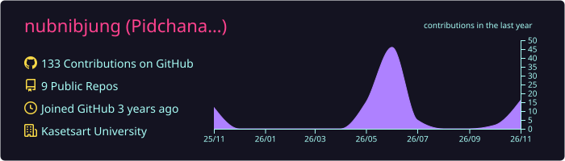
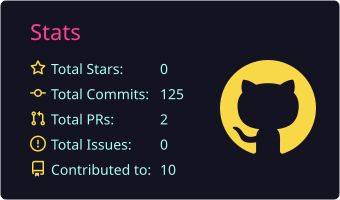
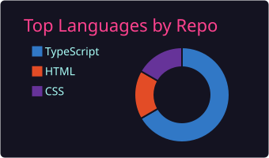
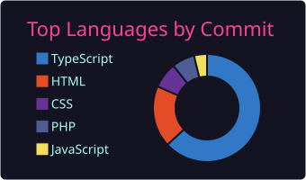
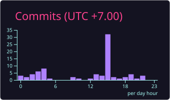

[README (2).md](https://github.com/user-attachments/files/34513666/README.2.md)
<div align="center">


<a href="https://github.com/nubnibjung">
  
</a>
<div align="center">



<a href="https://github.com/nubnibjung">
  
</a>
<br/>

 <b>Hi, I'm Pidchanard — welcome to my little corner of GitHub</b> 


</div>

<br/>



##  &nbsp;About Me

<div align="center">



<br/><br/>

&nbsp;
&nbsp;
&nbsp;
&nbsp;
&nbsp;


</div>


##  &nbsp;Tech Arsenal

<div align="center">


**Languages**


**Frameworks & Libraries**


**Database, Tools & Cloud**


</div>

> 💡 แก้รายการไอคอนได้ที่พารามิเตอร์ `i=` ดูชื่อทั้งหมดที่ [skillicons.dev](https://skillicons.dev)


##  &nbsp;Featured Projects

<table>
<tr>
<td width="50%" valign="top">

### ☁️ cloud-cut-pidchanard
_ใส่คำอธิบายโปรเจกต์ที่นี่_


[](https://github.com/nubnibjung/cloud-cut-pidchanard)

</td>
<td width="50%" valign="top">

### 🏢 Commonfee-management
ระบบจัดการค่าส่วนกลาง (fork + contribute)


[](https://github.com/nubnibjung/Commonfee-management)

</td>
</tr>
<tr>
<td width="50%" valign="top">

### 🌌 The-Nomad-Space-test
_ใส่คำอธิบายโปรเจกต์ที่นี่_


[](https://github.com/nubnibjung/The-Nomad-Space-test)

</td>
<td width="50%" valign="top">

### 🍦 icecream_shop
เว็บร้านไอศกรีม


[](https://github.com/pidchanard/icecream_shop)

</td>
</tr>
</table>


##  &nbsp;GitHub Dashboard

<div align="center">









</div>

###  Snake Eats My Contributions

<div align="center">

<picture>
  <source media="(prefers-color-scheme: dark)" srcset="https://raw.githubusercontent.com/nubnibjung/nubnibjung/output/github-snake-dark.svg" />
  <source media="(prefers-color-scheme: light)" srcset="https://raw.githubusercontent.com/nubnibjung/nubnibjung/output/github-snake.svg" />
  
</picture>

</div>

> 🐍 งู snake จะแสดงหลังจากเพิ่มไฟล์ `.github/workflows/snake.yml` (แนบมาด้วย) แล้วรัน workflow ครั้งแรก


##  &nbsp;Roadmap 2026

- [x] 🌱 เริ่มทำโปรเจกต์เว็บแรก
- [x] 🦈 ได้ achievement **Pull Shark**
- [x] 🌐 ทำเว็บพอร์ตโฟลิโอขึ้น Vercel
- [ ] 🔥 ทำโปรเจกต์ Full-Stack ให้จบ 1 ตัว
- [ ] 🧠 เรียนรู้ System Design และ Cloud
- [ ] 🤝 Contribute open source ให้ครบ 10 PR
- [ ] 💼 สมัครฝึกงาน


##  &nbsp;Random Dev Quote

<div align="center">


</div>

##  &nbsp;Let's Connect

<div align="center">

[](https://pidchanard-mueanson.vercel.app)
[](https://www.instagram.com/__qrxzz)
[](https://www.facebook.com/gid.pidchanard.mueanson)
[](https://github.com/nubnibjung)

<br/>

 <b>ถ้าชอบโปรไฟล์นี้ กดดาวให้ repo ได้เลยนะ</b> 


</div>

<br/>


</div>

<br/>


## 🌸 &nbsp;About Me

<table>
<tr>
<td width="60%">

```js
const pidchanard = {
  name: "Pidchanard Mueanson",
  alias: "nubnibjung",
  school: "Kasetsart University 🎓",
  location: "Thailand 🇹🇭",
  currentlyLearning: ["Next.js", "System Design", "Cloud"],
  currentlyBuilding: ["cloud-cut-pidchanard", "The-Nomad-Space"],
  funFact: "I debug with snacks 🍿",
  lookingFor: "Collabs, internships & good vibes ✨",
};
```

</td>
<td width="40%" align="center">


<br/><br/>


</td>
</tr>
</table>


## 💅 &nbsp;Tech Arsenal

<div align="center">

**Languages**


**Frameworks & Libraries**


**Database, Tools & Cloud**


</div>

> 💡 แก้รายการไอคอนได้ที่พารามิเตอร์ `i=` ดูชื่อทั้งหมดที่ [skillicons.dev](https://skillicons.dev)


## 🎀 &nbsp;Featured Projects

<table>
<tr>
<td width="50%" valign="top">

### ☁️ cloud-cut-pidchanard
_ใส่คำอธิบายโปรเจกต์ที่นี่_


[](https://github.com/nubnibjung/cloud-cut-pidchanard)

</td>
<td width="50%" valign="top">

### 🏢 Commonfee-management
ระบบจัดการค่าส่วนกลาง (fork + contribute)


[](https://github.com/nubnibjung/Commonfee-management)

</td>
</tr>
<tr>
<td width="50%" valign="top">

### 🌌 The-Nomad-Space-test
_ใส่คำอธิบายโปรเจกต์ที่นี่_


[](https://github.com/nubnibjung/The-Nomad-Space-test)

</td>
<td width="50%" valign="top">

### 🍦 icecream_shop
เว็บร้านไอศกรีม


[](https://github.com/pidchanard/icecream_shop)

</td>
</tr>
</table>


## 💗 &nbsp;GitHub Dashboard

<div align="center">


<br/>


<br/>


</div>

### 📈 Contribution Graph


### 🐍 Snake Eats My Contributions

<div align="center">

<picture>
  <source media="(prefers-color-scheme: dark)" srcset="https://raw.githubusercontent.com/nubnibjung/nubnibjung/output/github-snake-dark.svg" />
  <source media="(prefers-color-scheme: light)" srcset="https://raw.githubusercontent.com/nubnibjung/nubnibjung/output/github-snake.svg" />
  
</picture>

</div>

> 🐍 งู snake จะแสดงหลังจากเพิ่มไฟล์ `.github/workflows/snake.yml` (แนบมาด้วย) แล้วรัน workflow ครั้งแรก


## 🌷 &nbsp;Roadmap 2026

- [x] 🌱 เริ่มทำโปรเจกต์เว็บแรก
- [x] 🦈 ได้ achievement **Pull Shark**
- [x] 🌐 ทำเว็บพอร์ตโฟลิโอขึ้น Vercel
- [ ] 🔥 ทำโปรเจกต์ Full-Stack ให้จบ 1 ตัว
- [ ] 🧠 เรียนรู้ System Design และ Cloud
- [ ] 🤝 Contribute open source ให้ครบ 10 PR
- [ ] 💼 สมัครฝึกงาน


## 💌 &nbsp;Random Dev Quote

<div align="center">


</div>

## 🩷 &nbsp;Let's Connect

<div align="center">

[](https://pidchanard-mueanson.vercel.app)
[](https://www.instagram.com/__qrxzz)
[](https://www.facebook.com/gid.pidchanard.mueanson)
[](https://github.com/nubnibjung)

<br/>

**💖 ถ้าชอบโปรไฟล์นี้ กดดาวให้ repo ได้เลยนะ 💖**


</div>
